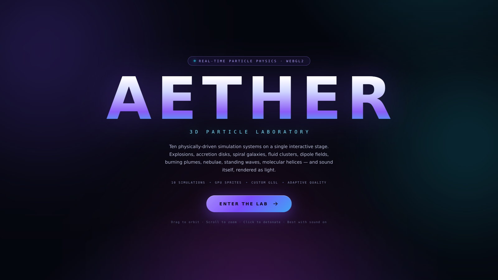
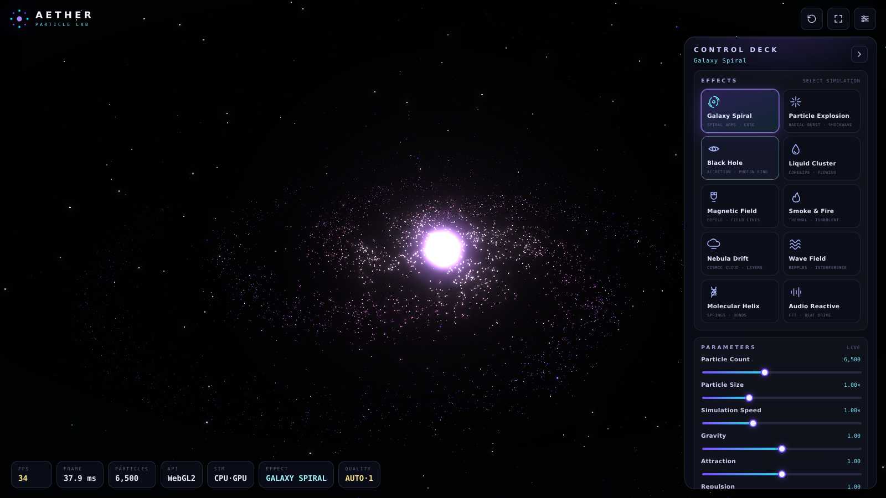
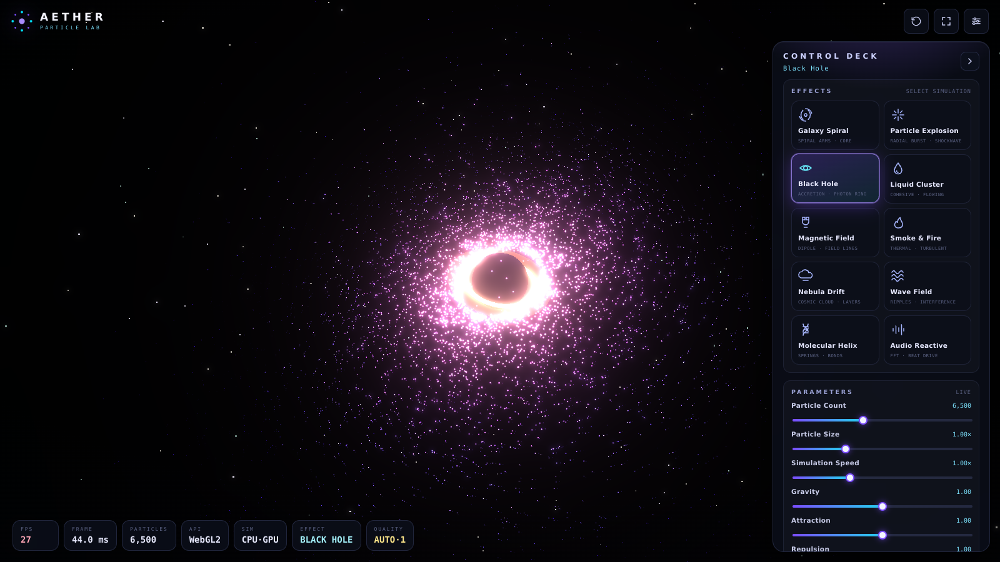
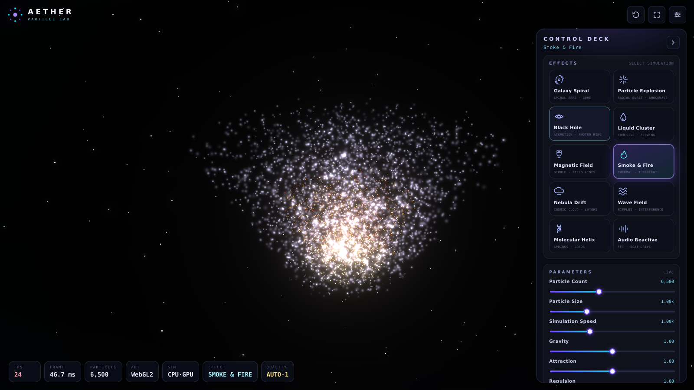
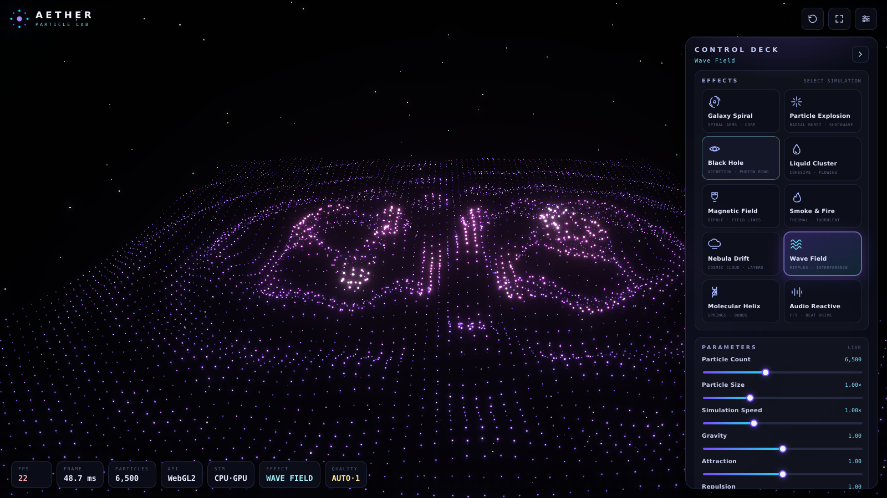
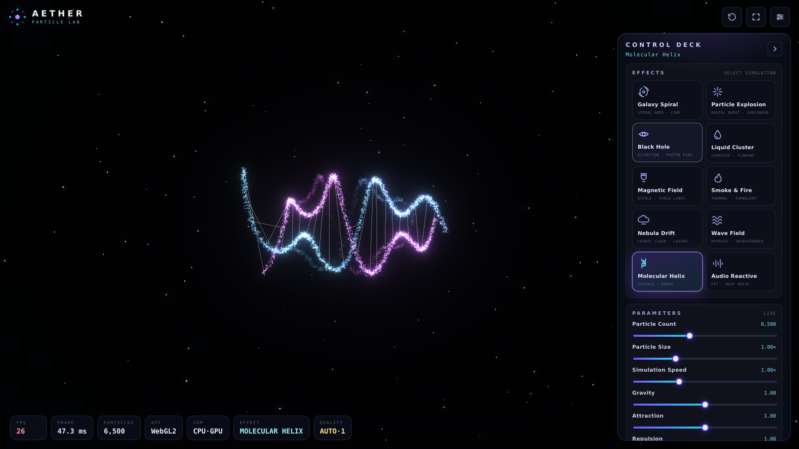

# AETHER — 3D Particle Laboratory

An interactive, real-time laboratory of **10 physically-driven 3D particle simulations**, rendered in the browser with WebGL2, Three.js and custom GLSL point-sprite shaders. Every effect is a live simulation — not a canned animation — with 12 live parameters, 6 color ramps, adaptive quality and microphone/file/demo audio reactivity.



## Quick start

```bash
npm ci              # install (Node ≥ 18)
npm run dev         # local dev server (http://localhost:5173)
npm run build       # type-check + production build → dist/
npm run preview     # serve the production build (http://localhost:4173)
npm test            # Vitest unit suite (44 tests)
npm run e2e         # Playwright/Chromium end-to-end (41 checks + screenshots)
npm run typecheck   # tsc --noEmit
```

Then open the app, press **Enter the Lab**, and pick a simulation. Deep-link directly with `/?effect=blackhole` (any of the ids below).

## The ten simulations

| # | Effect | What it is | Screenshot |
|---|--------|------------|------------|
| 1 | **Galaxy Spiral** | Differentially-rotating two-arm spiral with a core that "breathes", murmurs and feeds on inflowing gas |  |
| 2 | **Particle Explosion** | Radial burst with shockwave ring, sparks and smoke fall-off | |
| 3 | **Black Hole** | Accretion disk, photon ring, relativistic jet and a dark event-horizon sphere |  |
| 4 | **Liquid Cluster** | Cohesive metal-like droplet with rim glow and surface tension flow | |
| 5 | **Magnetic Field** | Two-pole dipole with 3D field-line cages, orbiting charged grains and pole glow | |
| 6 | **Smoke & Fire** | Rising ember plume: physical temperature ramp (white-hot → ash), grey volumetric smoke cap |  |
| 7 | **Nebula Drift** | Three layered cosmic clouds with palette-tinted inner glow, slow internal churn | |
| 8 | **Wave Field** | A ripple tank: two orbiting coherent sources interfere; pointer wells act as driven wave sources; clicks splash the membrane |  |
| 9 | **Molecular Helix** | Spring-mass double helix — ball-and-stick atoms, backbone rails and rungs; click to knock it out of equilibrium |  |
| 10 | **Audio Reactive** | Bass/mids/treble FFT bands drive ring radius, particle energy and beat pulses (mic, audio file, or built-in demo signal) | |

## Interacting

- **Orbit** — drag to rotate, scroll to zoom, auto-gentle idle drift.
- **Wells** — click/tap the stage: a gravitational well pulls (or, with repulsion held, pushes) particles. On the Wave Field, clicks splash the membrane.
- **Control Deck** (right panel) — 10 simulation cards, 12 live sliders (particle count 500–16 000, size, speed, gravity, attraction, repulsion, turbulence, rotation, opacity, glow, bloom, trail), 6 gradient palettes, 3 quality presets.
- **Quality** — the adaptive governor starts at full fidelity and steps down (pixel-ratio cap + particle budget) only when the rolling FPS floor is breached, then restores after ~6 good seconds (hysteresis — no oscillation). The rail shows `FULL` or `AUTO-1…3`. Manual override: **Performance / Balanced (default) / Ultra** radio group, capping device pixel ratio at 1.0 / 1.5 / 2.0.
- **Audio** — *Demo signal* works out of the box; *Use Microphone* needs mic permission; *Load audio file* plays any local track. The Audio Reactive effect reads bass, mid and treble energy at 60 Hz.
- **Space** pauses/resumes · **Esc** closes dialogs.
- Preferences persist in `localStorage`; respects `prefers-reduced-motion` on first visit.

## Architecture

```
src/
├─ engine/          Core loop & renderer
│  ├─ ParticleEngine.ts    Three.js renderer, ACES filmic tone mapping,
│  │                       UnrealBloom, adaptive quality wiring, shockwaves
│  ├─ ParticleSystem.ts    Flat Float32Array SoA buffers (positions, colors,
│  │                       alphas, sizes) — zero per-frame allocation
│  ├─ AdaptiveQuality.ts   Rolling-FPS quality governor with hysteresis
│  ├─ CameraController.ts  Orbit + idle drift
│  ├─ palettes.ts          6 multi-stop gradients → 256-entry LUTs
│  └─ SimplexNoise.ts      3D curl noise for turbulence
├─ effects/         10 simulations + catalog.ts (single source for the UI gallery)
│  └─ effectUtils.ts       sdt(), colorFromLUT() shared helpers
├─ audio/AudioEngine.ts    Web Audio FFT (analyser @ 60 Hz), mic/file/demo sources
├─ state/SettingsStore.ts  Typed settings, clamped ranges, localStorage persistence
├─ ui/                     ControlPanel, StatsRail (telemetry), Toast
└─ shaders/                Point-sprite vertex/fragment, noise + shockwave passes
```

**Simulation notes**

- All motion runs on the CPU in flat typed arrays; rendering is a single draw call of additive-blended point sprites with per-particle color/alpha/size attributes.
- Each effect implements `ParticleEffect` (`init` / `update`) against a shared `EffectContext` (time, params, palette LUT, pointer wells, shockwave spawner) — adding an 11th effect is one file plus one catalog entry.
- Particle count is live-resizable (500–16 000) with no re-allocation of the GPU buffers; overflow grids (Wave Field) park excess particles invisibly.
- Colors come from 256×3 gradient LUTs built per frame from the active palette — whole-scene re-tinting is one uniform-free attribute rewrite.

## Testing & quality gates

- **`npm test`** — 44 Vitest unit tests: math/LUT/RNG utils, settings sanitization & persistence, adaptive-quality hysteresis state machine, palette/catalog integrity.
- **`npm run e2e`** — 41 checks in headless Chromium (SwiftShader): boot, WebGL2 context, all 10 effects render non-blank, slider wiring, palette/quality/pause/reset flows, mic (fake device) & demo audio fallback, performance floor, 390×844 mobile layout, rapid-switch + reload regression, zero console/page errors. Screenshots land in `e2e/screenshots/` (git-ignored; regenerate with `npm run e2e`).
- Benchmarks and measurement methodology: [docs/PERFORMANCE.md](docs/PERFORMANCE.md).

## Browser support

Any modern browser with **WebGL2** (Chrome/Edge 90+, Firefox 98+, Safari 15.2+). Without WebGL2 the app fails gracefully with a clear on-screen error. Headless testing uses SwiftShader (software GL) — see PERFORMANCE.md for what that means for the numbers.

## Repository history

This repository previously hosted the **SyncBeat** prototype (a multi-device video/audio sync PoC). It has been removed from the tree; the final SyncBeat state remains reachable in git history (≤ `ee3ff00`).

## License

[MIT](package.json)
